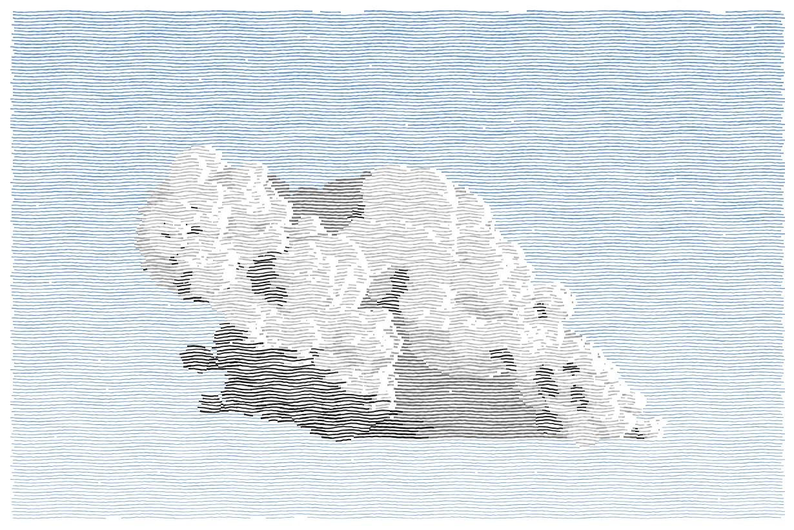

# Cumulus

[](https://github.com/joshua-dallas/cumulus/actions/workflows/ci.yml)

A custom HTML element, `<cumulus-canvas>`, that draws a generative cumulus cloud on a canvas in a hand-hatched style. The picture is made of thousands of short, slightly wavy horizontal strokes whose colour gives the shade. Each cloud is built from a seed number, so the same seed always gives the same cloud.



**[Live demo](https://joshua-dallas.github.io/cumulus/)**: click the cloud for a new one, fade the sky to a sunset, and move the shadow edge.

- Plain ES modules, no framework, no runtime dependencies.
- Draws in a web worker (on an `OffscreenCanvas`) so it never blocks the page, with a main-thread fallback.
- Pauses when scrolled out of view or when the tab is hidden, and respects `prefers-reduced-motion`.
- Type declarations included (generated from JSDoc).

## Install

The package is installed from GitHub for now (it is not on the npm registry yet):

```sh
npm install github:joshua-dallas/cumulus#v1.0.2
```

Use a release tag (see the [tags](https://github.com/joshua-dallas/cumulus/tags)), not just the branch, so an install always gets the same code. Installing runs `npm run build` (the `prepare` script), so the machine doing the install needs `git` and a normal Node setup. Import it by the package name, `@joshua-dallas/cumulus`, as below. To update, install a newer tag. If npm reports that the install script of `@joshua-dallas/cumulus` was skipped, allow it with `npm install-scripts approve @joshua-dallas/cumulus`.

## Use

```html
<cumulus-canvas width="600" height="400" seed="323" numCells="15"></cumulus-canvas>
<script type="module">
  import "@joshua-dallas/cumulus/define"; // registers <cumulus-canvas>
</script>
```

To register the element under your own name, import the class instead:

```js
import { Cumulus } from "@joshua-dallas/cumulus";
customElements.define("my-cloud", Cumulus);
```

### Attributes

Changing an attribute rebuilds the cloud (except `sunset` and `sunsetDuration`). Attribute names are case-insensitive in HTML, so `numCells` and `numcells` are the same.

| Attribute           | Default | Description                                                                                                                  |
| ------------------- | ------- | ---------------------------------------------------------------------------------------------------------------------------- |
| `width`             | 500     | Canvas width in CSS pixels. If omitted, the element's CSS width is used                                                      |
| `height`            | 500     | Canvas height in CSS pixels. If omitted, the element's CSS height is used                                                    |
| `numCells`          | 15      | Number of main circles forming the cloud (max 100)                                                                           |
| `seed`              | random  | Seed for the generator (a random one if omitted; `currentSeed` tells you which)                                              |
| `lineWidth`         | 1       | Hatch line thickness                                                                                                         |
| `lineSpacing`       | 1.5     | Gap between hatch lines                                                                                                      |
| `growIn`            | off     | The cloud grows from nothing when the element is first created                                                               |
| `regenerateOnClick` | off     | Clicking the cloud shrinks it away and grows a new one (new random seed)                                                     |
| `mouseRepel`        | off     | Cells slide sideways out of the way of the mouse, and return when it leaves                                                  |
| `sunset`            | off     | The sky is a sunset. Adding or removing the attribute fades the sky from blue to orange and raises the shadow, or fades back |
| `sunsetDuration`    | 6000    | How long the sunset fade takes, in ms                                                                                        |

`growIn`, `regenerateOnClick`, `mouseRepel` and `sunset` are on when the attribute is present and off when it is missing or set to `false`.

```html
<cumulus-canvas width="600" height="400" growIn regenerateOnClick></cumulus-canvas>
```

A resize rebuild does not replay the grow-in, and a cloud made by clicking keeps its seed through a rebuild until the `seed` attribute is changed.

### JavaScript API

- `element.currentSeed`: the seed of the cloud on show.
- `seedchange` event: fired (it bubbles) when a click gives the cloud a new seed. `event.detail.seed` is the seed.
- `element.setShadowDiagonal({ day: { angle, xOriginOffset }, sunset: { ... } })`: moves the edge of the shadow. Angles are in radians; `xOriginOffset` is where the edge meets the base of the dome, measured from the dome centre in dome radii (negative is left). Anything left out is unchanged.
- `element.setThemeValues({ colours: { dark: { light: 40 } }, layers: { cell: { lineWidth: 1.5 } } })`: changes colours (hue, saturation, lightness), line widths, wave periods and amplitudes, and padding (`paddingScale`) of the layers. Only the values passed are changed, and they last through rebuilds.

The demo page uses all of these: its sliders call `setThemeValues` and `setShadowDiagonal` and show the changed values as JSON.

### Colours and the page behind

The spaces between the lines are see-through, so whatever is behind the canvas on the page shows through them. The gaps within a line (the padding beside the cloud's cells and fractals) are drawn in the paper colour, `background.paper` in the theme (white by default). Unset it to make those gaps see-through too.

### Mouse, resizing, motion

- **Mouse:** the mouse can click (`regenerateOnClick`) and push cells sideways out of its way (`mouseRepel`).
- **Resizing:** leave `width` and `height` off and size the element with CSS (for example `cumulus-canvas { width: 100%; height: 400px }`) to make the cloud fill its container. It is rebuilt when the element's size changes, drawn at the device pixel ratio current at that time (a zoom or monitor change on its own does not trigger a rebuild yet).
- **Performance and accessibility:** the animation pauses while the element is scrolled out of view or the tab is hidden. With `prefers-reduced-motion: reduce` the finished cloud is drawn once, with no animation and no mouse effect.

### Browser support

Any current browser with ES modules and custom elements. Where a web worker can draw to a canvas (`OffscreenCanvas`), the cloud is built and drawn in a worker; otherwise it runs on the main thread. The worker file is found relative to the built library, so `dist/` works wherever it is served. A site that pre-bundles the package (for example Vite's dev `optimizeDeps`) can break that relative URL; exclude the package from pre-bundling if so.

## How it works

A cloud is modelled as three kinds of shape, built by `CloudBuilder` (`src/lib/cloud-builder.js`):

- **Cells**: circles that make up the body of the cloud.
- **Fills**: regions between cells (polygons and half-circles along the centre line) that are shaded differently.
- **Fractals**: small light and dark circles inside each cell that give the fluffy look.

`Cumulus` (`src/cumulus.js`) is the custom element and handles attributes, resizing and lifecycle. It creates a `CumulusController` (`src/lib/cumulus-controller.js`), which turns the cloud into styled layers (styles live in `src/lib/theme.js`), moves the cells with `CloudSimulation` and hands the layers to the renderer (`src/lib/hatched-renderer.js`). The renderer splits the canvas into horizontal lines, works out which layer is visible along each stretch of each line, and strokes each stretch as a wavy, noisy line, with a diagonal shadow edge across the cloud. See [docs/ARCHITECTURE.md](docs/ARCHITECTURE.md) for a detailed walkthrough.

## Development

```sh
npm install
npm run dev          # then open /demo/
npm run build        # library output in dist/, with type declarations in dist/types/
npm run build:demo   # the demo page for GitHub Pages, in dist-demo/
npm run lint         # ESLint
npm run format       # Prettier (format:check only checks)
npm test             # unit tests (no browser needed)
npm run test:e2e     # the element in a real browser (Playwright; run `npx playwright install chromium` once)
npm run check        # lint, format check, tests and build: what CI runs
```

The unit tests use Node's built-in runner and run without a browser. The custom element itself is tested in Chromium with Playwright (`e2e/`).

The demo is deployed to GitHub Pages by `.github/workflows/pages.yml` on every push to `main` (the repository's Pages source must be set to "GitHub Actions").

## Known limitations

- About 1% of seeds build a cloud slightly past the canvas edge (up to about 13px), left or right.
- Moving cells vertically tears the fills, so the mouse push is sideways only.
- Changing the generation code changes the cloud every seed makes; the tests keep a golden hash of seed 323 to catch that.

## Roadmap

What is done and what is planned is in [ROADMAP.md](ROADMAP.md).

## Licence

[PolyForm Noncommercial 1.0.0](LICENSE): free to use, copy and change for any noncommercial purpose. This is source-available, not open source, because commercial use needs separate permission. Get in touch for a commercial licence.
